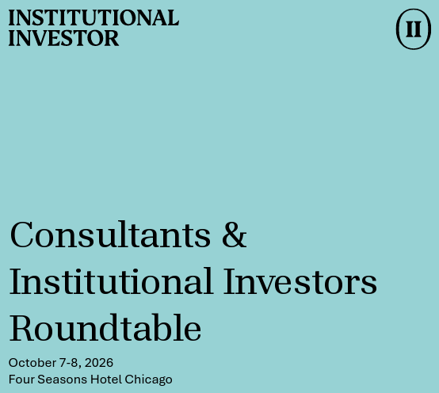
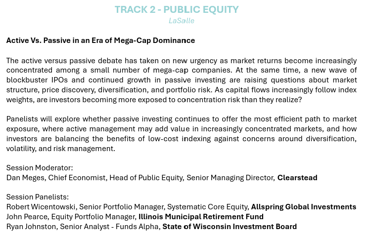

I participated as a panelist discussing the role of active and passive equity investing styles at the [Institutional Investor](https://www.institutionalinvestor.com/) Consultants & Institutional Investors Roundtable in Chicago.

# Discussion Points

-   Using external and internal management to seek alpha and beta
-   Opportunities for alpha in international equities and smaller capitalization segments of the US market
-   How the changing investment landscape reshapes my thinking about the use of active and passive equity strategies

